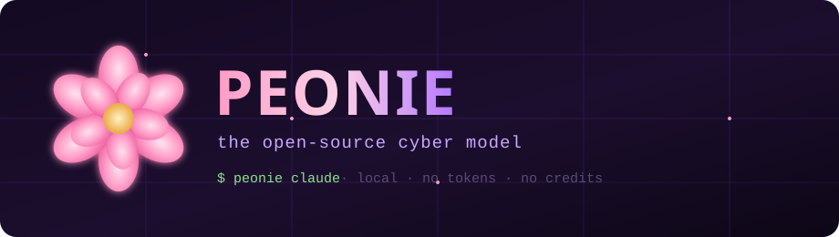

<div align="center">



<br/>

<a href="#-quickstart"></a>
<a href="#-models"></a>
<a href="#license"></a>


<h3>Drive <b>Claude Code</b>, <b>Codex</b> and <b>CAI</b> with local, security-tuned open-weight models.</h3>
<p><i>Same muscle memory as a hosted cyber agent — <code>peonie claude</code> — but the model runs on your machine. Nothing is metered, nothing leaves the box.</i></p>

</div>

---

## 🌸 What is Peonie?

**Peonie is an open-source cyber model launcher.** It points the coding agents you already know — Claude Code, OpenAI Codex, and [CAI](https://github.com/aliasrobotics/CAI) — at **local, security-tuned LLMs** served by [Ollama](https://ollama.com). You type `peonie claude` and get a full agentic security workstation that costs **nothing per request**, has **no rate limits**, and **never sends your code or binaries to a third party**.

```
         ┌──────────────┐        ┌───────────────────────┐
  you →  │ peonie claude│  ───►  │  local Ollama server  │
         │ peonie codex │        │  ┌─────────────────┐  │
         │ peonie cai   │        │  │ peonie-code     │  │  Qwen3-Coder 30B
         └──────────────┘        │  │ peonie-cyber    │  │  DeepHat V1 7B
                ▲                 │  │ peonie-sec      │  │  Foundation-Sec 8B
                │                 │  └─────────────────┘  │
          no API key              └───────────────────────┘
          no credits                   all on your GPU/CPU
```

Think of it as the free, self-hosted answer to metered "cyber AI" services: the agent harness is open, the weights are open, and the only bill is your electricity.

---

## ✨ Features

- 🧠 **Three security models, one launcher** — an agentic driver, an offensive-security specialist, and a threat-intel reasoner. Switch with `--model`.
- 🔌 **Works with the tools you know** — Claude Code, Codex, and CAI, unmodified. Peonie just rewires their endpoint.
- 🔒 **Air-gapped by design** — after the one-time model pull, it runs with the network off. Ideal for pre-release, NDA, or patent-sensitive code.
- 🛡️ **Built-in CVE scanning** — `peonie scan ./build` runs `cve-bin-tool` + `trivy` and can emit a CycloneDX SBOM.
- 💸 **Zero marginal cost** — no tokens, no credits, no "out of credit" walls. Run it all day.
- 🪶 **No lock-in** — plain Ollama Modelfiles and a ~400-line Node CLI. Read it, fork it, swap the models.

---

## 🚀 Quickstart

> **Requirements:** [Node.js 18+](https://nodejs.org), a GPU with ≥6 GB VRAM *or* ≥16 GB RAM, and ~30 GB free disk for the full model set.

### Windows (PowerShell)
```powershell
git clone https://github.com/MAXIVA11/Peonie "$env:LOCALAPPDATA\Peonie"
cd "$env:LOCALAPPDATA\Peonie"
./install.ps1
```

### Linux / macOS
```bash
git clone https://github.com/MAXIVA11/Peonie ~/.local/share/Peonie
cd ~/.local/share/Peonie
./install.sh
```

The installer puts a `peonie` launcher on your `PATH`, installs Ollama if needed, pulls the model bases, and builds the Peonie models. Then:

```bash
peonie doctor        # verify tools, server and models
peonie claude        # Claude Code, on a local cyber model  🌸
```

That's it. `peonie claude` behaves exactly like launching the agent normally — same UI, same tools — but every token is generated on your machine.

---

## 🧠 Models

| Profile | Model | Base | Best at |
|---|---|---|---|
| `code` *(default)* | **peonie-code** | Qwen3-Coder 30B (MoE, 3.3B active) | Agentic work — driving Claude Code / Codex, editing, tool use |
| `cyber` | **peonie-cyber** | [DeepHat V1 7B](https://huggingface.co/DeepHat/DeepHat-V1-7B) *(ex-WhiteRabbitNeo)* | Offensive & defensive security reasoning, exploit PoC, hardening |
| `sec` | **peonie-sec** | [Cisco Foundation-Sec 8B](https://huggingface.co/fdtn-ai/Foundation-Sec-8B-Reasoning-Q4_K_M-GGUF) | CVE/CWE analysis, MITRE ATT&CK mapping, threat intel |

```bash
peonie claude                 # default agentic driver
peonie claude --model cyber   # offensive-security specialist
peonie cai   --model cyber    # CAI pentest agent on DeepHat
peonie scan ./dist --sbom     # CVE scan + CycloneDX SBOM
```

---

## 🧩 Commands

| Command | What it does |
|---|---|
| `peonie claude [args]` | Launch **Claude Code** on a local Peonie model |
| `peonie codex [args]`  | Launch **Codex CLI** on a local Peonie model |
| `peonie cai [args]`    | Launch **CAI** (Cybersecurity AI) on a local model |
| `peonie scan <path>`   | CVE-scan a binary/dir (`cve-bin-tool` + `trivy`), `--sbom` for CycloneDX |
| `peonie setup`         | Pull model bases and build the Peonie models |
| `peonie models`        | Show the model catalog |
| `peonie serve`         | Ensure the local Ollama server is up |
| `peonie doctor`        | Health-check tools, server and models |

All agent commands accept `--model code\|cyber\|sec` (or any local Ollama model name) and pass remaining arguments straight through to the underlying tool.

---

## 🛡️ CVE scanning for your own builds

Peonie bundles a thin wrapper over best-in-class **offline** scanners so you can gate releases before they ship:

```bash
peonie scan ./build           # cve-bin-tool + trivy, known-CVE coverage
peonie scan ./build --sbom    # also writes peonie-sbom.json (CycloneDX)
```

Install the scanners once (`pip install cve-bin-tool`, `trivy` via your package manager, optional `syft`/`grype` from Anchore). Their vulnerability databases download once and then run fully offline — no uploads, no accounts.

---

## ⚖️ Honest caveats

- **Local models are not frontier models.** `peonie-code` is a capable agent and `peonie-cyber` knows security well, but neither matches a top hosted model on the hardest reverse-engineering or subtle-bug reasoning. Use Peonie for volume, privacy, and offline work; reach for a frontier model when you're stuck.
- **Quality scales with hardware.** A 30B model wants a decent GPU or lots of RAM. On ≤8 GB VRAM it offloads to CPU and runs slower — still usable, just not instant.
- **The models are "uncensored" for security.** They will discuss and generate offensive tooling. Use Peonie only against systems **you own or are authorised to test.**
- **Scanners find _known_ CVEs in third-party components,** not novel bugs in your own code. Pair with SAST/fuzzing for full coverage.

---

## 🌼 Why "Peonie"?

The peony: layered, resilient, and in many traditions a symbol of bravery and protection. Fitting for a tool meant to help defenders look at their own work the way an attacker would — in the open, and for free.

## License

[MIT](./LICENSE) for the Peonie launcher. The underlying **models carry their own licenses** (Apache-2.0 with extensions for DeepHat, and the respective licenses for Qwen and Foundation-Sec) — see [`NOTICE.md`](./NOTICE.md). You are responsible for complying with them and for using Peonie only in authorised testing.

<div align="center"><sub>🌸 Peonie · made for defenders · runs on your machine, on your terms</sub></div>
